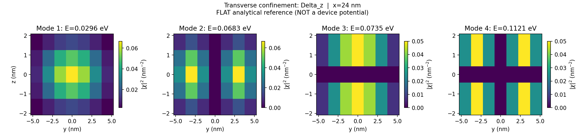
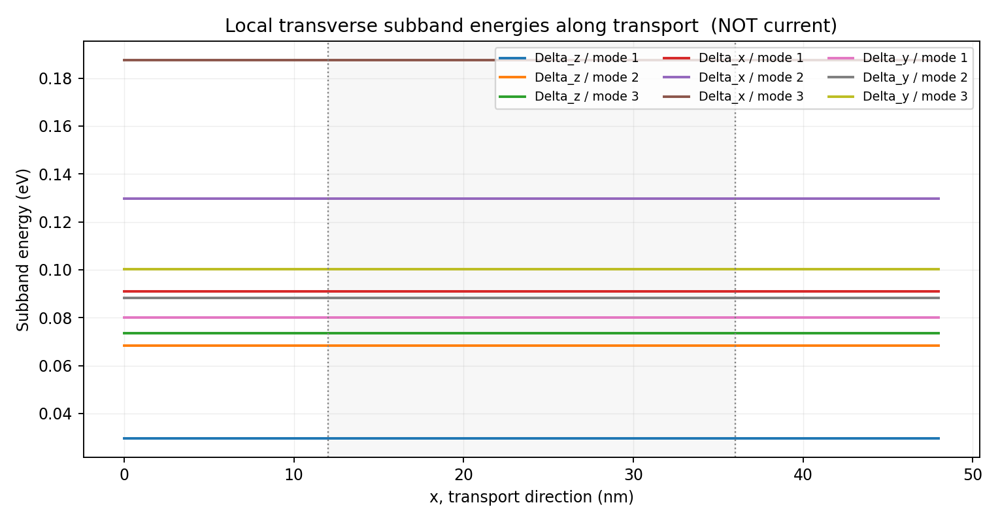
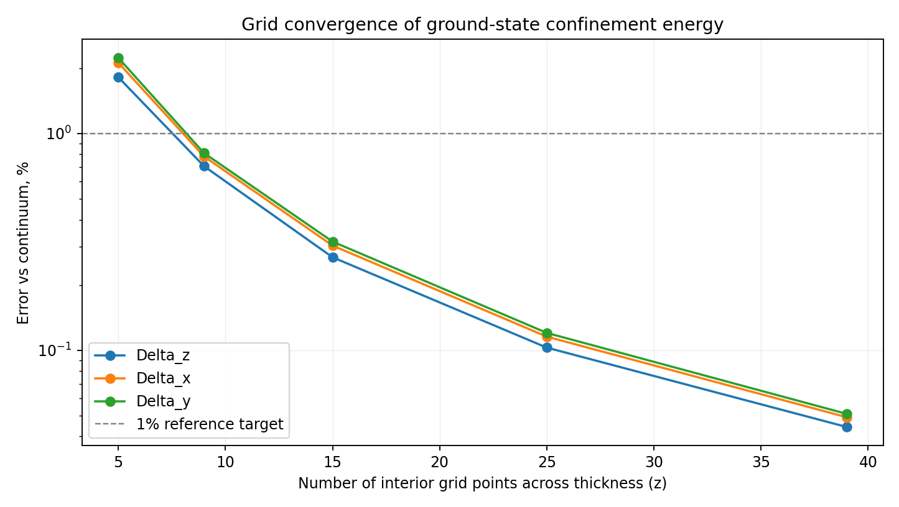
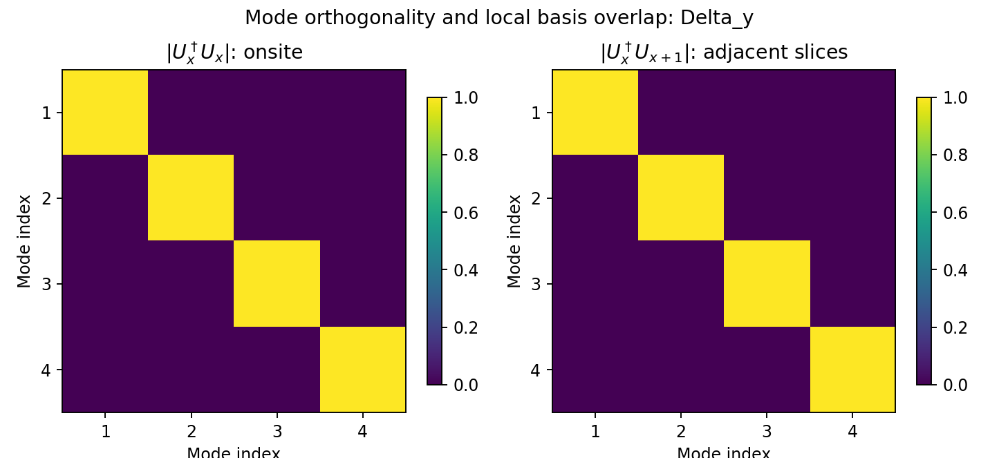
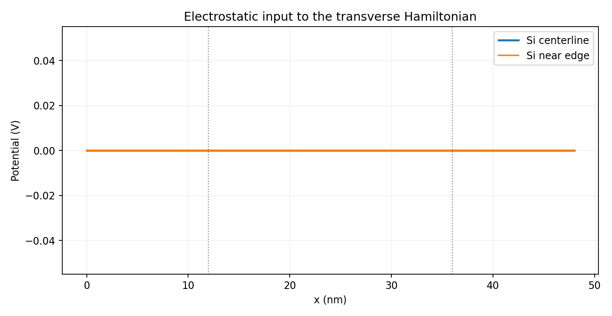

# STEP 02 — PASS

**Input potential:** FLAT analytical reference (NOT a device potential)

**Scope:** 2D transverse mode-space numerical validation only; no device NEGF current is calculated.

| Check | Outcome |
|---|---|
| exact_2d_fd_eigenvalues | PASS |
| orthonormal_modes | PASS |
| continuum_ground_under_1_percent | PASS |
| finite_values | PASS |

