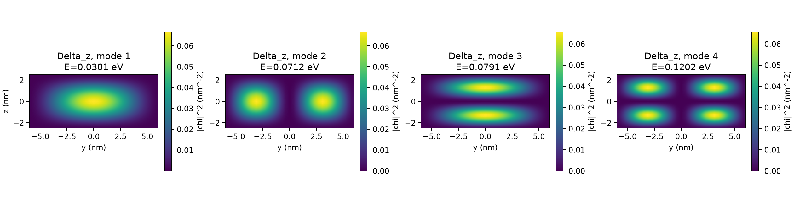
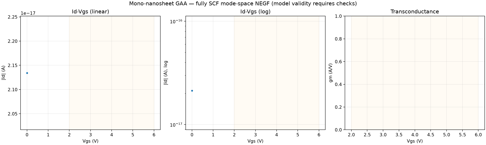
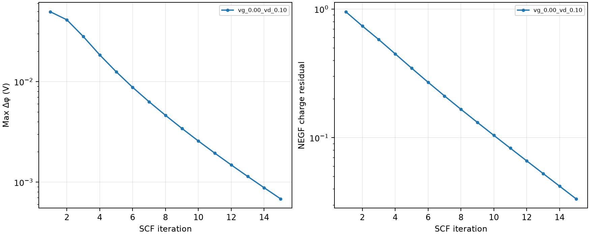

# STEP03 — Real-device Mode-Space NEGF Validation

> All plots are calculated from actual DEVSIM coupled SCF runs. This is an uncalibrated ballistic EMA prototype, NOT measurement-grade silicon TCAD.

- Id–Vgs converged: 1/2
- Id–Vds converged: 0/0
- Transverse: 31 × 25, longitudinal: 345 nodes, modes/valley: 6
- Minimum discrete lead bandwidth: 8.545 eV
- Gate flatband adjustment: 0.500 V (assumption, NOT calibrated)
- HIGH-BIAS WARNING: 0–6 V with a 2 nm SiO2 is outside typical reliable oxide-operation conditions; breakdown, leakage and scattering are omitted.
- The infinite hard-wall confinement and ideal source/drain contact models are assumptions.
- Off-current may be sensitive to energy integration and contact/band alignment.

## Plots

