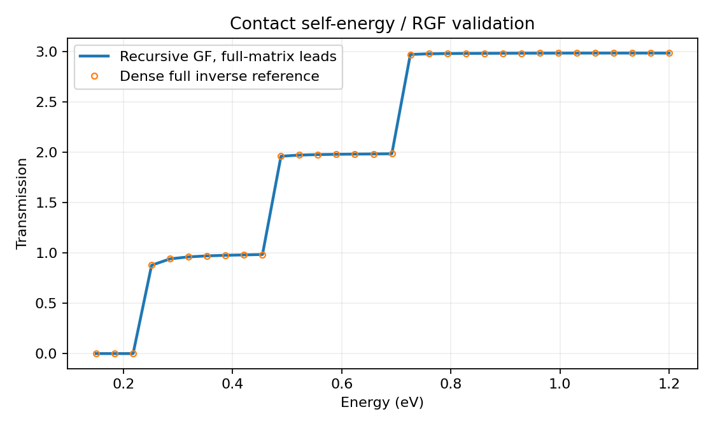
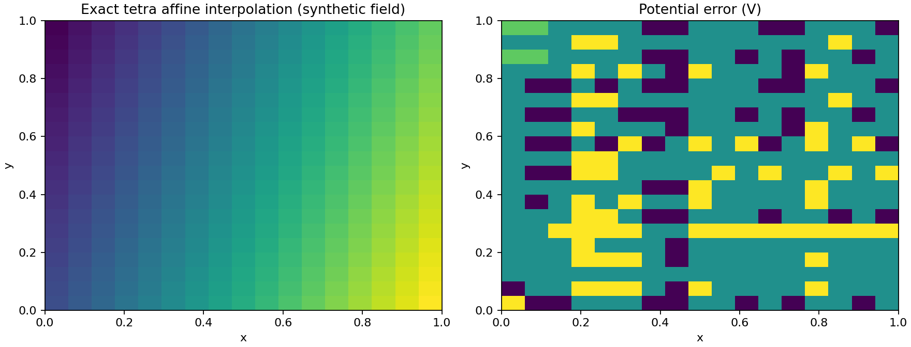
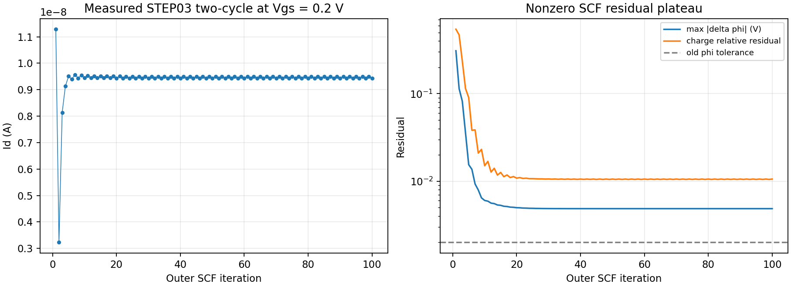
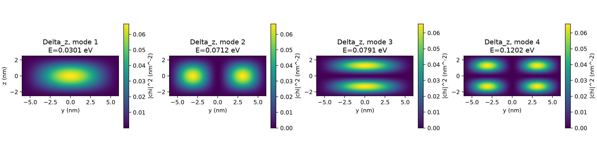
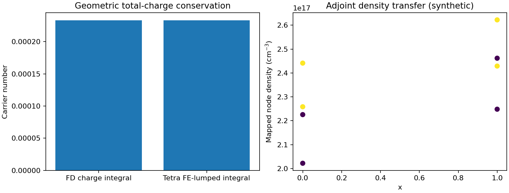
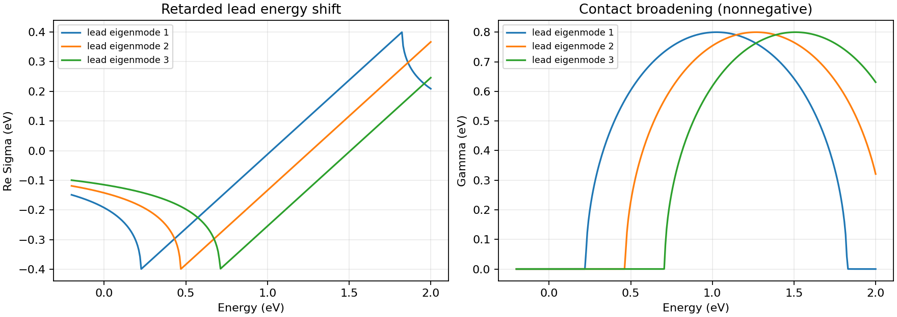

# STEP04 — Numerical diagnostics

**Only manufactured field and small exact NEGF tests. Not a real-device SCF pass.**

- PASS: True
- tetra interpolation max error: 4.441e-16 V
- Geometric discrete charge mismatch: 2.743e-15
- RGF vs full inverse max T error: 4.663e-15
- RGF spectral density matrix max error: 2.220e-14

