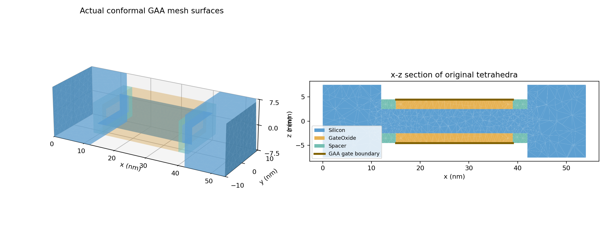
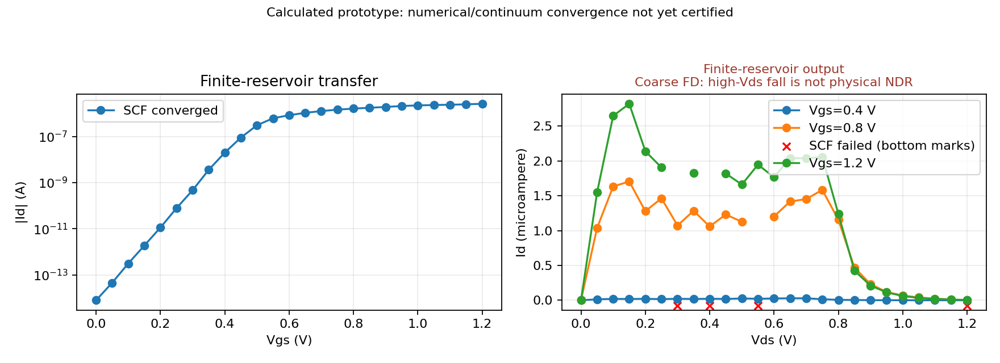
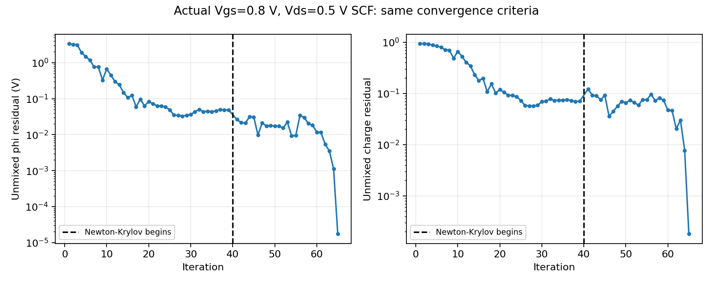

# STEP05: implemented and actually executed

**연구용 prototype 구현과 계산을 완료했다. 정량 소자 검증 완료 또는 lab DeepSCF 학습 완료를 뜻하지 않는다.**

## 실제 실행 결과

| 항목 | 실제 결과 |
|---|---|
| Id-Vgs | 25/25 SCF converged; Vgs=0:1.2:0.05 V, Vds=0.1 V |
| Id-Vds | 71/75 SCF converged; Vgs=0.4,0.8,1.2 V, Vds=0:1.2:0.05 V |
| Tests | 24 passed, including actual 3D heterogeneous DEVSIM potential/displacement continuity |
| Vds=0 | 실제 3개 gate 조건 모두 Id=0; 동일 density matrix의 undriven channel flux 검사 |
| Default mesh | 24581 tetrahedra, 3202 Si nodes; CAD Si volume=9000 nm^3 |
| Original-tetra affine phi | max error 1.332e-15 V |
| Density mapping | constant relative error 1.995e-09, charge error 5.631e-16 |
| Poisson-only | donor-neutral zero-field solution exact; gate response and all 3 material/interface groups verified |
| Actual-device spectral check | dE=0.5 meV current vs bond current mismatch 0.0323% |
| Direct GF vs pole T(E) | max absolute error 1.371e-14, 5 energies x 3 valleys |
| Chain finite vs semi-infinite | best ideal Landauer current mismatch 0.156%; separate numerical/contact benchmark |

실행된 I-V는 dx=1 nm, dy=dz=1 nm, channel/S/D modes=3/6 per valley, gamma=10 meV이다.
coarse Gmsh sizes는 bulk/channel/junction=3.5/1.8/1.3 nm이다. 기본값 전체 quantum I-V를 실행했다고 주장하지 않는다.
default dx=0.25 nm, mesh=2.5/1.2/0.9 nm의 **실제 Poisson + mapping 검증**은 별도로 실행했다.

SCF 기준은 unmixed potential residual <1e-4 V, volume-weighted charge residual <2e-3,
current change <2e-3이다. 작은 mixing update를 수렴으로 바꾸거나 기준을 느슨하게 하지 않았다.
Anderson 정체 시 같은 physical fixed point에 Newton-Krylov/Armijo를 사용한다.
별도 고바이어스 사례 Vgs=0.8, Vds=0.5 V는 65 iterations에 수렴했다.

현재 미수렴 output bias (Vgs,Vds): `[[0.8, 0.55], [0.8, 1.2], [1.2, 0.3], [1.2, 0.4]]`.
해당 current는 CSV의 NOT_CONVERGED 진단 값으로만 남기고 정상 I-V line에서 제외했다.

## 수렴성 campaign: 아직 인증할 수 없는 이유

아래는 모두 Vgs=0.8 V, Vds=0.1 V에서 다시 수행한 실제 3D SCF이다.
한 단계 refinement의 agreement는 전체 수렴의 증명이 아니다.

| Case | Id (uA) | baseline 대비 | barrier 변화 (meV) |
|---|---:|---:|---:|
| baseline | 1.633246 | +0.00% | +0.000 |
| basis_local | 1.235551 | -24.35% | +3.301 |
| gamma_20mev | 1.693073 | +3.66% | -10.196 |
| gamma_5mev | 1.276600 | -21.84% | +5.964 |
| longitudinal_fine | 1.031972 | -36.81% | -1.647 |
| mesh_medium | 1.658217 | +1.53% | -1.833 |
| mixing_unscreened | 1.633634 | +0.02% | -0.004 |
| modes_high | 2.121087 | +29.87% | -9.344 |
| modes_low | 1.669921 | +2.25% | +4.440 |
| source_drain_24nm | 2.038731 | +24.83% | -6.067 |
| transverse_fine | 1.565590 | -4.14% | -1.045 |

* Poisson mesh refinement의 Id 변화는 약 1.5%였지만, longitudinal refinement는 약 -37%,
  mode 증가는 약 +30%, finite S/D 12->24 nm는 약 +25%, local vs fixed basis는 약 -24%였다.
* gamma=5->10->20 meV에서 안정된 plateau가 확정되지 않았다. finite electrode 및 contact model 검증이 남았다.
* isolated source donor count는 같은 masses/modes/filling에서 machine precision으로 calibration했지만,
  연결된 outer-half S/D의 density-vs-donor 오차는 약 10-19%였다. finite hard-wall surface와 reservoir/geometry 영향도
  포함되므로 이를 bulk-like neutrality 통과로 해석하지 않는다. 전체 Si의 gate-induced net charge를 0으로 강제하지 않는다.
* balanced charge map은 constants/positivity/charge를 보존하지만 affine potential interpolation의 정확한 adjoint는 아니다.
  실제 mapping work defect가 남으며, density smoothing과 mesh dependence를 더 줄여야 한다.
  세 실제 bias의 전하 적분 오차는 0~3.0e-16이지만, 실제 phi/n의 work defect는 약 2.20-3.25%였다.
* native DEVSIM NodeVolume의 geometric volume 차이를 발견하여 original-tetra signed flux와 positive control volume을
  실제 DEVSIM equation integration에 설정했다. 이 conservative vertex balance는 P1 tetra Galerkin stiffness와 동등하다.

**고 Vds output current 감소를 물리적 NDR 또는 검증된 saturation으로 해석하지 않는다.**
dx=1 nm에서 Delta_x longitudinal FD bandwidth는 약 0.166 eV이다.
1.2 V sweep은 이 discretization의 안전한 transport 범위를 넘는다. default dx=.25 nm에서는 약 2.66 eV로 늘지만
추가적인 dx/modes/bath convergence 검사가 여전히 필요하다. 그림이 그럴듯하다는 이유로 성공 판정을 내리지 않았다.

## Transfer 지표: prototype 값

| 지표 | 값 |
|---|---:|
| Constant-current Vth | 0.348660 V |
| Minimum sampled SS | 59.423 mV/dec |
| gm,max | 5.349042e-06 A/V |
| Ion at Vgs=1.2 V | 2.647416e-06 A |
| Ioff at Vgs=0 V | 7.864258e-15 A |
| Ion/Ioff | 3.366390e+08 |

Vth criterion=1e-7 A/um x GAA perimeter 0.034 um =3.4e-9 A.
SS는 adjacent positive log slope의 최소값이다. 이 값들은 실험값에 calibration하거나 convergence-certified한 소자 사양이 아니다.

## STEP04와 비교

| 항목 | STEP04 (기존 코드/STATUS 확인) | STEP05 |
|---|---|---|
| Geometry | straight nanosheet; raised S/D/spacer 부재 | raised Si S/D + suspended bridge + 4-sided oxide/gate + spacer |
| Contact mu | illustrative fixed 0.15 eV | 같은 finite source의 donor number로 calibration |
| Density | semi-infinite lead self-energy, energy RGF/injectivity | finite spectral analytic Fermi correlation; no energy-by-energy GF in SCF |
| Embedding | semi-infinite spatial leads | explicit wide-band external environment on finite electrodes |
| Poisson integration | existing native DEVSIM scheme | explicitly assembled signed conservative tetra flux/control volume |
| Convergence | checked existing STATUS says 4/5; not rerun here | actual transfer/output counts above, all residuals saved |
| Same-device comparison | not available for raised geometry | not claimed; homogeneous chain limit and direct finite-GF checks executed |

STEP01-04의 tracked files는 base commit `95fc5fd`와 차이가 없다.
같은 geometry/contact/calibration에서 STEP04 대비 전류나 속도가 개선됐다고 주장하지 않는다.

## MS와 DeepSCF의 현재 경계

`ms` backend는 논문의 spatial occupation rule을 진단하는 별도 실험 경로다.
Vgs=0.4, Vds=0에서 closed finite EMA-Poisson equilibrium SCF/zero current를 실제 확인했다.
bias-window origin이 모호한 standing/bound states는 거부한다. constrained-search variational MS-DFT가 아니다.
default `spectral` backend는 외부 bath가 coherence/occupation/DC current를 유지하는 별도 모델이다.
semi-infinite surface GF는 없지만 `-i Gamma/2`라는 bath embedding은 명시적으로 존재한다.

DeepSCF neural network/weights는 이 저장소에 없으므로 lab model을 이식/학습 완료했다고 주장하지 않는다.
whole-bias split의 charge dataset export와 checked warm-start interface를 구현했다.
prototype 25 points로 RBF-ridge baseline만 실제 train/holdout 평가했다: 20 train, 5 heldout,
heldout log10 RMSE 약 0.0499, density relative L2 약 15.1%. 정량 검증된 학습 정답은 0개다.
같은 설정의 실제 Vgs=0.7, Vds=0.1 V에서 baseline을 initial guess로 사용하고 reference SCF로 다시 검증했다.
reference SCF를 끄는 production inference 경로는 제공하지 않는다.

## 다음 실행 순서

1. `job.sh`로 fine-dx 한 바이어스부터 실행하고 .25->.125 nm, mode count, transverse grid를 함께 수렴시킨다.
2. S/D length와 gamma를 함께 증가/감소시키며 plateau, contact neutrality와 surface effect를 검사한다.
3. 같은 raised geometry에서 semi-infinite NEGF reference와 frozen-potential 및 full SCF 비교를 한다.
4. 검증된 reference에서 전체 bias/device 단위 holdout을 구성한 뒤 lab DeepSCF에 channel-density target을 연결한다.

default finite Hamiltonian은 valley당 1680-dimensional dense complex problem이다.
sparse transverse eigensolve와 달리 density matrix diagonalization은 dense이며, runtime은 cubic하게 증가한다.
이 구현이 RGF보다 빠르거나 neural inference 속도/정확도가 확보됐다는 주장은 하지 않는다.

## 결과 미리보기

자세한 실행 명령은 README, 이론/근거/새 가정은 THEORY, 원시 숫자와 설정은 results에 있다.
원격 push는 첨부 프롬프트의 승인 조건에 따라 수행하지 않았다.
